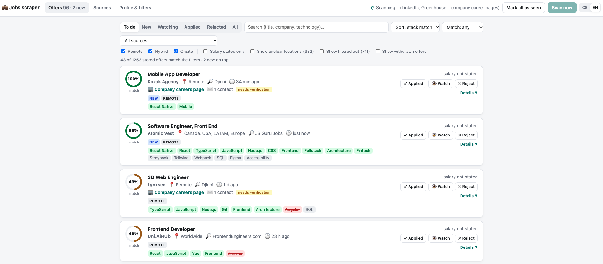
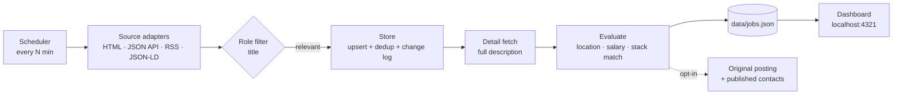

# Jobs Scraper

**A self-hosted job radar for frontend and React Native developers.** It scans 30+ job boards and ~50 company career pages every hour. It keeps only the offers that match your role, location and salary, scores how well each one fits your tech stack, and merges the same offer found on different portals into one card. You triage everything in a local dashboard: **Applied**, **Watch** or **Reject**.

Everything runs on your machine. There's no account, no cloud, no AI at runtime, and your data never leaves the `data/` folder.



> The dashboard is available in **English and Czech** (switch **CS | EN** in the header; the default follows your system language). The default filters are tuned for the Czech / EU market (Brno, remote from Czechia, salary in CZK). All of it is editable, see [Configuration](#configuration).

---

## Features

- **34 sources out of the box:** Czech portals, EU and remote job boards, and the public APIs of applicant tracking systems (Greenhouse, Ashby, Lever, SmartRecruiters, Recruitee) for ~50 companies. You can add any site as RSS, a JSON-LD page or a generic HTML page with CSS selectors.
- **Hourly scanning:** one scan at startup, then every *N* minutes. State is saved after every source, so you can stop the app at any time and nothing is lost.
- **Smart filtering:**
  - **Role:** frontend, React / React Native, mobile, web, tech lead, team lead. Junior, QA, native-only iOS/Android, backend-only and similar roles are filtered out.
  - **Location:** onsite or hybrid only in your city, remote anywhere if the region allows working from your country.
  - **Salary:** a minimum monthly salary in CZK. Hourly, man-day and yearly rates in any currency are converted using the daily rates from the Czech National Bank.
- **Stack match (0–100 %):** the listing's technologies are compared with your profile, where *core* skills count ×3, *strong* ×2 and *familiar* ×1, and *avoid* skills lower the score. You can paste your CV or LinkedIn "Skills" text to import technologies.
- **Cross-portal deduplication:** the same offer from LinkedIn, Jobs.cz and the company's own career page shows up as **one card** with "also on" links. Titles are normalised (gender markers, "– Remote", "Sr." → "Senior"), and so are company names (`Rohlik Group` = `Rohlik`).
- **Change tracking:** a **NEW** badge since you last marked everything as seen, a **CHANGED** badge for salary, title or location changes, and a **GONE** badge for offers that disappeared from the portal.
- **Original posting lookup** *(opt-in):* finds the offer on the employer's own website or ATS and the contacts *published* there, labelled "nutno ověřit" (*needs verification*). Recruitment-agency postings are detected and their contacts skipped.
- **macOS notifications** for new matching offers.

## Quick start

Requires **Node.js ≥ 22.18**. TypeScript runs natively through Node's type stripping, so there's no build step.

```bash
git clone <this-repo> jobs-scraper && cd jobs-scraper
npm install
npm start            # opens http://localhost:4321 and runs the first scan
```

The first scan takes about 2 minutes. Cards appear as each source finishes.

| Command | What it does |
| --- | --- |
| `npm start` | Dashboard + immediate scan + a scan every hour. Stop with `Ctrl+C`. |
| `npm run start:quiet` | The same, without opening the browser. |
| `npm run scan [sourceId]` | One-off scan without the dashboard. Prints the top matches. If the dashboard is running, it asks the dashboard to scan instead. |
| `npm test` | Unit tests (salary parser, filters, stack match, dedup, URL guard). |
| `npm run typecheck` | `tsc --noEmit` |

Optional environment variables (see `.env.example`):
- `PORT`: dashboard port, default `4321`
- `JOOBLE_API_KEY`: enables the Jooble source; get a free key from Jooble

`yarn` works too (`yarn start`).

## How it works



1. **Adapters** (`src/sources/`) turn each portal's search page, API or feed into a common `RawJob` shape. Each source is one adapter type plus a list of URLs, usually search URLs copied from the browser with your filters applied.
2. **Role filter:** listings whose title doesn't look like your role are dropped right away and never stored.
3. **Store** (`src/store.ts`): new offers are added. Known ones are updated, and salary, title or location changes are logged. Duplicates across portals are folded into one card.
4. **Detail fetch:** for listings without a description, the detail page is fetched once (preferably its schema.org `JobPosting` JSON-LD) to get an accurate stack match and to detect remote work and salary.
5. **Evaluation** (`src/filters.ts`, `src/match.ts`, `src/salary.ts`) produces a verdict (`ok` / `unclear` / `fail`) with human-readable reasons, plus a stack match score.
6. **Dashboard** (`public/`): a vanilla JS app served by a tiny Node HTTP server, with live updates over Server-Sent Events.

More detail: [architecture.md](architecture.md) · [testing.md](testing.md)

## Using the dashboard

- **Offers:** your inbox.
  - Filter by status (*To do* = new + watched), search, minimum match, work mode and source.
  - Each card shows the match ring, matched skills (green), skills missing from your profile (grey), avoided skills (red), salary with its CZK/month equivalent, and badges.
  - Buttons: **✓ Applied**, **👁 Watch**, **✕ Reject**. Clicking the active state again resets it.
  - **Detail** shows the description, a change history, links to the same offer on other portals, the original-posting lookup and a private note.
- **Sources:** enable or disable sources, edit their URLs and page limits, run a single source, see the last run (fetched / relevant / new / errors), or add your own source.
- **Profile & filters:** the skill tags of your stack profile, CV / LinkedIn text import, the salary threshold, the city for onsite work, role include / exclude patterns (regex), allowed and blocked remote regions, the scan interval, notifications and the original-posting lookup.

Changing the profile or filters re-evaluates all stored offers immediately.

## Sources

| Group | Sources |
| --- | --- |
| Czech / Slovak portals | Jobs.cz, Prace.cz, Profesia.cz, Profesia.sk, StartupJobs.cz (via sitemap + JSON-LD), Jobstack.it, Easy-práce.cz, JobsContact.cz |
| EU & remote boards | No Fluff Jobs, Djinni, Bulldogjob.pl, EuroTechJobs, Landing.jobs, Arbeitnow, Remote OK, Remotive, We Work Remotely (RSS), Himalayas, Jobicy, Working Nomads, Remote Rocketship, Remote.com, Arc.dev, FrontendEngineers.com, ReactJobs.io, JS Guru Jobs |
| Company career pages (ATS) | Greenhouse, Ashby, Lever, SmartRecruiters, Recruitee. One URL = one company board, e.g. `https://jobs.ashbyhq.com/<company>`. |
| Opt-in | **LinkedIn** guest search (disabled by default, see [Responsible use](#responsible-use)), **Jooble** official API (needs `JOOBLE_API_KEY`) |
| Generic | RSS/Atom feed · page embedding schema.org `JobPosting` · any server-rendered page with CSS selectors |

**Not supported:**
- Indeed, Glassdoor, pracuj.pl, theprotocol.it and startup.jobs sit behind anti-bot challenges. This tool doesn't try to bypass them.
- Welcome to the Jungle and JustJoin.it have no public server-side data.

### Adding a source

In the dashboard, open **Sources → + Add source**, pick a type and paste URLs. The hint under the type shows the expected URL format. For example:
- add a company to the **Greenhouse / Ashby / Lever** source as one more URL line: `https://job-boards.greenhouse.io/<company>`
- **RSS:** any feed URL
- **HTML:** the listing URL plus CSS selectors for `item` and `title` (required) and optionally `link`, `company`, `location` and `salary`

To add a new portal in code, see [architecture.md](architecture.md#adding-a-new-portal).

## Configuration

Everything is editable in the dashboard and saved to `data/config.json`. The defaults are an **example profile**: a senior React / React Native / TypeScript developer in Brno, Czech Republic, with a minimum of 100,000 CZK per month. Change them to yours.

| Setting | Default | Meaning |
| --- | --- | --- |
| Min. salary | 100 000 CZK / month | Compared with the upper bound of the range. Hourly ×160, man-day ×20, yearly ÷12. |
| Hide unknown salary | off | Offers without a salary are kept by default. |
| Language | your system language (`LANG`) | Dashboard, desktop notifications and terminal logs. |
| Onsite cities | Brno | Onsite / hybrid allowed only there; everything else must be remote. |
| Remote allowed / blocked regions | worldwide, EU, Europe, EMEA, CET, Czechia… / US, LATAM, India… | Decides whether a remote offer can be done from your country. |
| Scan interval | 60 min | |
| Detail fetches per scan | 150 | Descriptions are filled in gradually over the following scans. |
| Original-posting lookup per scan | **0 (off)** | Opt-in, see below. |

New default sources added in later versions are merged into your existing config once. A default source you deleted stays deleted.

## Original posting & contacts (opt-in)

When enabled (Settings → *Original posting & contact lookup – offers per scan*), or for a single job with the button in its detail, the tool tries to find the offer on the employer's own site. It stops at the first strategy that works:

1. The listing already points to the company's ATS, its domain or its microsite (e.g. `company.jobs.cz`), or the portal redirects there.
2. An "Apply" link, the company website from JSON-LD, or a link to the company domain on the portal page.
3. A domain guessed from the company name, accepted only if the site's title contains the name.
4. The career page (menu link, `careers.` / `kariera.` subdomain, `/careers`), then a link with a matching title (≥ 75 %).

Only these count as **original**: an ATS, a company microsite, or a domain carrying the company name. Shorteners, aggregators and unrelated domains are shown only as "external link (unverified)".

**Contacts:**
- Only e-mails and phone numbers literally published in the posting or on the career page are kept. Addresses are never guessed.
- From the homepage or a general career page, only job mailboxes (`hr@`, `jobs@`, `info@`…) are taken, no personal addresses.
- Agency postings are detected, and their contacts are dropped.
- Everything is labelled *needs verification* and stored only locally.

## Data & privacy

All state lives in `data/`, which is git-ignored:

| File | Contents |
| --- | --- |
| `jobs.json` | Offers, your statuses and notes, the change history, cross-portal links, lookup results |
| `config.json` | Profile, filters, sources, settings |
| `scan-state.json` | Last run of each source |
| `rates.json` | Cached exchange rates |

Writes are atomic (temp file + rename). A corrupted file is backed up as `*.corrupt-<timestamp>` instead of being overwritten. To reset, delete `data/`.

## Security

The dashboard is a **single-user local tool**:
- It binds to `127.0.0.1` only.
- It rejects foreign `Host` headers (DNS rebinding) and cross-origin write requests (CSRF), and requires JSON on writes.
- Scraped content is rendered only via `textContent`, and links are limited to `http(s)` and `mailto:`.
- Every outgoing request and every redirect hop goes through an SSRF guard. It allows only `http(s)` and blocks localhost, private, link-local, CGNAT and multicast ranges, including IPv4-mapped IPv6 forms. Known limitation: DNS rebinding between the DNS check and the connection isn't prevented.

**Don't expose it to the internet as is.** It has no authentication and no per-user data, and it isn't hardened for multi-user hosting.

## Responsible use

This project is for **personal job searching**. Before you enable or add a source:
- **Check the site's terms of use and robots.txt.** Some portals forbid automated access. LinkedIn does, which is why it's off by default. The FrontendEngineers adapter, for example, uses only public category pages, because `/api/` is disallowed in robots.txt and job details are paywalled.
- **Be polite.** The defaults scan hourly with 1.2–2.5 s gaps between requests to the same host. Don't lower them aggressively.
- **Respect API terms.** Some APIs (Remote OK, Jobicy, Himalayas) ask for attribution. Don't republish their data.
- **Contacts are personal data.** Use them only for your own application, don't share them, and delete what you don't need. Running this as a public service or redistributing the collected data is a different legal situation (terms of service, database rights, GDPR) and needs its own review.

The software is provided as is, without warranty. You're responsible for how you use it.

## License

[MIT](LICENSE)
